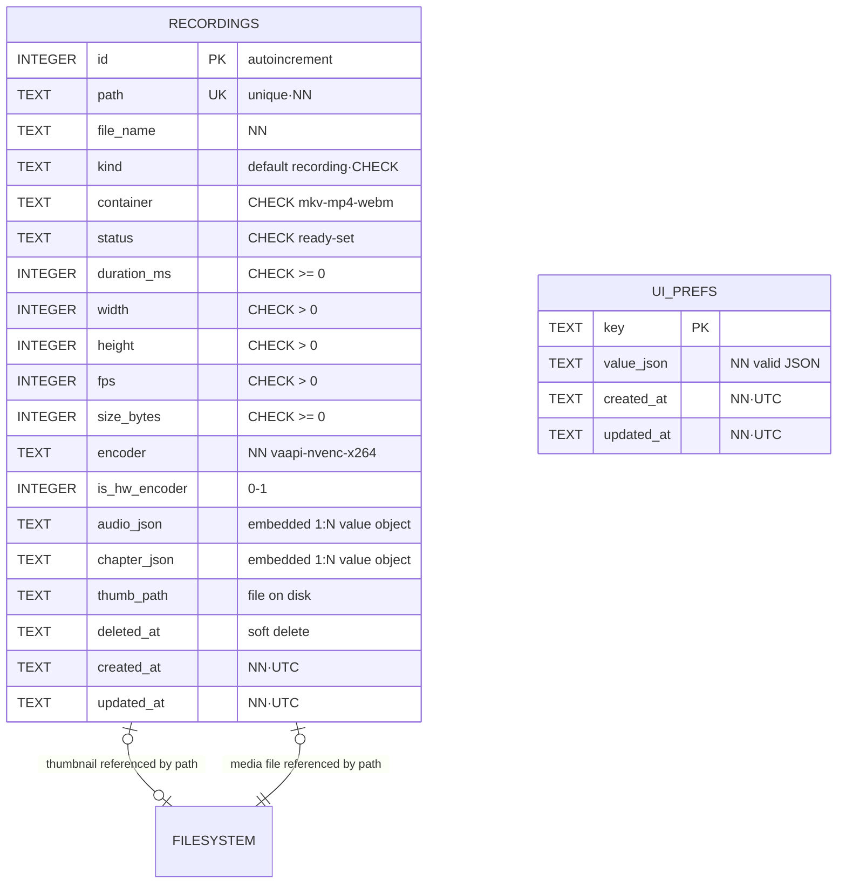

# DATABASE.md — ScreenStudio Pro

**Version:** 1.0 · **Authority chain:** PRD.md → ARCHITECTURE.md (§6 SQLite discipline) → this file
**Rule:** This is a local metadata index, not a data warehouse. Only what's needed for PRD MVP features (M9 files, M14 library, UI prefs) plus the single V2 seam. Adding tables beyond this requires a PRD justification.

---

## 1. Scope & Engine Decisions

| Decision | Choice | Reason |
|---|---|---|
| Engine | **SQLite 3 via `rusqlite`** | Embedded, zero-admin, universally documented (ARCHITECTURE.md stack) |
| File locations | Data: `$XDG_DATA_DIR/screen-studio-pro/library.db` · thumbnails beside it | XDG hygiene (ARCHITECTURE §5.3) |
| Journal mode | `PRAGMA journal_mode = WAL` | Single-writer reads-during-write: UI queries never block the recording pipeline |
| Concurrency | One writer connection (pipeline), one reader connection (UI queries) | Matches ARCHITECTURE §6 "single writer" discipline |
| Migrations | Hand-rolled via `PRAGMA user_version`, versioned `.sql` files embedded with `include_str!` | `rusqlite` has no built-in migrations; this adds no dependency — simple and debuggable |
| Callers | Recordings rows are written by the **pipeline** (after finalize), read by the **library view**; `ui_prefs` written by UI commands | Matches the state-ownership law in ARCHITECTURE §4 |

**Deliberate non-normalization (and why):** audio sources and chapter markers live as JSON inside `recordings`. These are value objects attached 1:1 to a recording — no other table ever references them, they're always read *with* the recording, and normalizing them would add joins for zero query payoff. JSON with app-side validation is the normalized-enough choice here. Files themselves (MP4s, PNG thumbs) stay on disk; the DB only holds references.

---

## 2. Tables

### 2.1 `recordings` — the library index

| Column | Type | PK/FK | Default | Constraints | Notes |
|---|---|---|---|---|---|
| `id` | INTEGER | **PK** | AUTOINCREMENT | — | Rowid alias |
| `path` | TEXT | | | **NOT NULL · UNIQUE** | Absolute path to the media file. Uniqueness = the filesystem is the source of files, DB the index |
| `file_name` | TEXT | | | NOT NULL | Display name (`screen-2026-11-01-1405.mp4`) |
| `kind` | TEXT | | `'recording'` | NOT NULL · CHECK in `('recording','screenshot','stream_marker')` | The V2 seam: `screenshot` (V2) and `stream_marker` (V2) reuse this index |
| `container` | TEXT | | | NOT NULL · CHECK in `('mkv','mp4','webm')` | Final muxed container |
| `status` | TEXT | | `'ready'` | NOT NULL · CHECK in `('recording','finalizing','ready','missing')` | Pipeline writes during session; library shows `ready` only; `missing` = file vanished (DESIGN §5.5 error card) |
| `duration_ms` | INTEGER | | 0 | NOT NULL · CHECK (`duration_ms >= 0`) | |
| `width` | INTEGER | | | CHECK (`width > 0`) | NULL until finalize |
| `height` | INTEGER | | | CHECK (`height > 0`) | NULL until finalize |
| `fps` | INTEGER | | | CHECK (`fps > 0`) | |
| `size_bytes` | INTEGER | | 0 | NOT NULL · CHECK (`size_bytes >= 0`) | |
| `encoder` | TEXT | | | NOT NULL | `'vaapi'` / `'nvenc'` / `'x264'` |
| `is_hw_encoder` | INTEGER | | 0 | NOT NULL · CHECK (`is_hw_encoder IN (0,1)`) | SQLite boolean |
| `audio_json` | TEXT | | `NULL` | Nullable | JSON array `[{source:'mic',device:'…',used:true},…]` — value object, see §1 |
| `chapter_json` | TEXT | | `NULL` | Nullable | JSON array `[{offset_ms: 4520, label:'setup'},…]` — flag markers (PRD flow 7.2). V2 export/pipeline may PROJECT these. DB is the store; MKV chapters at export are a projection, not a second source of truth |
| `thumb_path` | TEXT | | `NULL` | Nullable | Absolute path to PNG thumbnail (§ §1: files live on disk) |
| `deleted_at` | TEXT | | `NULL` | Nullable | **Soft delete.** Non-NULL = hidden from Library until the user empties trash |
| `created_at` | TEXT | | `strftime('%Y-%m-%dT%H:%M:%SZ','now')` | NOT NULL | ISO-8601 UTC (recording session start) |
| `updated_at` | TEXT | | `strftime('%Y-%m-%dT%H:%M:%SZ','now')` | NOT NULL | App-maintained on every write |

### 2.2 `ui_prefs` — key-value preferences

| Column | Type | PK/FK | Default | Constraints | Notes |
|---|---|---|---|---|---|
| `key` | TEXT | **PK** | | NOT NULL | e.g. `hud.position`, `pip.shape`, `pip.position`, `last.preset_id` |
| `value_json` | TEXT | | | NOT NULL | Single valid JSON value (string/number/object) — app-validated |
| `created_at` | TEXT | | `strftime('%Y-%m-%dT%H:%M:%SZ','now')` | NOT NULL | |
| `updated_at` | TEXT | | `strftime('%Y-%m-%dT%H:%M:%SZ','now')` | NOT NULL | App-maintained |

Note: `created_at`/`updated_at` are maintained by the app layer on upsert (SQLite has no native `DEFAULT ON UPDATE`); keep those columns `NOT NULL` with the timestamp literals above as write-in defaults.

---

## 3. Relationships (explained)

- **Everything here is intentionally flat.** `recordings` and `ui_prefs` share no keys.
- **Recording → media file:** one-to-one, deferred to the filesystem: `recordings.path` ↔ a file on disk. No FK possible (SQLite can't FK non-SQLite storage); the `status='missing'` state is the honest encoding of "FK could not be upheld."
- **Recording → thumbnail:** one-to-one (`thumb_path`), nullable until the finalize step generates it.
- **Recording → audio sources / chapters:** one-to-many *embedded* (JSON arrays within the row) — see §1 for why. Conceptually `1 recording : N audio sources` and `1 recording : N chapter markers`, materialized inline because they are always read together and never referenced elsewhere.
- **Recording → kind ('screenshot' / 'stream_marker'):** each row IS one artifact; V2 multi-source compositing (PRD V7) will add `source_json` or a `recording_sources` child table **only when V2 ships** — one-to-many at that point. Not built now.
- **ui_prefs:** isolated key-value, two conceptual groups (`hud.*`, `pip.*`, `last.*`) named by convention, no schema table.

---

## 4. ER Diagram (Mermaid)



---

## 5. Indexes (matched to the actual queries)

| Index | SQL (concept) | Serves | Why not more |
|---|---|---|---|
| `idx_recordings_created_at` | `ON recordings (created_at DESC)` | Library default sort "newest first" (PRD M14, §6.2); `LIMIT 50 + Show more` | The one hot query |
| `idx_recordings_status_deleted` | `ON recordings (status) WHERE deleted_at IS NULL` partial | Active-library queries exclude trashed rows cheaply | Partial keeps trash invisible to the hot path |
| `uq_recordings_path` | `UNIQUE (path)` (also the constraint) | Finalize-time upsert path check; file-manager "does this exist" | Covered by constraint |
| `idx_recordings_kind_deleted` | `ON recordings (kind) WHERE deleted_at IS NULL` partial | V2 library tabs (screenshot/stream_marker) without leaving the seam | Only built now because it costs ~nothing and is in PRD V-scope |
| `ui_prefs` PK | `INTEGER/BTREE on key` | `SELECT value_json WHERE key = ?` point lookup | PK is the index |

**Search strategy:** title/path search (`§6.2 search box`) uses `LIKE '%…%'` on `file_name || path`. At the scale this app will see (≤ a few thousand rows), that's fast enough — **full-text (FTS5) is explicitly not added**; if it ever is, it ships as migration `0003` with a documented reason.

---

## 6. Access Rules (row-level security reality check)

SQLite has **no RLS** — be honest in code and docs: access control happens at process and file level, enforced outside the DB:

1. **Single-tenant, single-user:** the app's own process is the only reader/writer; file permissions `0600` on `library.db` (matches the privacy expectation of desktop recordings).
2. **Role split at the connection level:** pipeline connection = writer only; library-view command handlers use the reader connection (no accidental `INSERT` from UI code — enforced by module architecture, not a SQL grant).
3. **Statement hygiene:** all queries are parameterized (`rusqlite` `params!`); no string-built SQL anywhere (a review-blocker).
4. **Integrity-first:** `PRAGMA foreign_keys = ON` (futureproof for a possible child table), `PRAGMA busy_timeout = 500` for the reader so UI waits never hard-fail against the writer's transaction.

---

## 7. Sample Seed Data

### 7.1 `ui_prefs` — first-run defaults (seed run on `user_version` 0 → 2 upgrade)

```sql
INSERT INTO ui_prefs (key, value_json) VALUES
  ('hud.position',      '"corner:bottom-right,margin:24"'),
  ('hud.pinned',        'false'),
  ('pip.shape',         '"circle"'),
  ('pip.position',      '"corner:bottom-right,margin:24"'),
  ('pip.size',          '220'),
  ('pip.self_insert',   'false'),
  ('last.preset_id',    '"youtube"');
```

(Note: `last.preset_id` seeds "For YouTube" — PRD M11's first preset.)

### 7.2 `recordings` — shape the rows will take (illustrative, not shipped seed: recordings only exist after real sessions)

```sql
-- Inserted by pipeline on stop (status 'ready' after remux+thumbnail):
INSERT INTO recordings
  (path, file_name, kind, container, status, duration_ms, width, height,
   fps, size_bytes, encoder, is_hw_encoder, audio_json, chapter_json, thumb_path)
VALUES
  ('/home/z/Videos/SSP/screen-2026-11-01-1405.mp4',
   'screen-2026-11-01-1405.mp4', 'recording', 'mp4', 'ready',
   102550, 2560, 1440, 60, 147174400, 'vaapi', 1,
   '[{"source":"mic","device":"blue-snowball","used":true},
     {"source":"desktop","device":"","used":true}]',
   '[{"offset_ms":4520,"label":"intro"},{"offset_ms":41800,"label":"demo2"}]',
   '/home/z/.local/share/screen-studio-pro/thumbs/2026-11-01-1405.png');
```

---

## 8. Migrations (order is the identity)

| Version | File | Contents |
|---|---|---|
| 0 | — | Empty DB (`user_version` 0) |
| **1** | `sql/0001_recordings.sql` | `CREATE TABLE recordings` (all columns §2.1) + `CREATE INDEX idx_recordings_created_at`, `idx_recordings_status_deleted`, `uq_recordings_path`, `idx_recordings_kind_deleted` — index ships **with** the table, never after |
| **2** | `sql/0002_ui_prefs.sql` | `CREATE TABLE ui_prefs` (§2.2) + seed inserts from §7.1 |
| (reserved) | `0003_full_text.sql` | **Not built.** Reserved only if search ever needs FTS5 (see §5 note) |

Migration rules: `.sql` files are embedded assets applied in order by ascending `user_version`, wrapped each in an implicit single transaction (`BEGIN`/`COMMIT` by the runner) — a failed migration leaves `user_version` at the last good step, no partial schema. New columns only ever `ALTER TABLE … ADD COLUMN` (SQLite-safe growth); never edit history.
