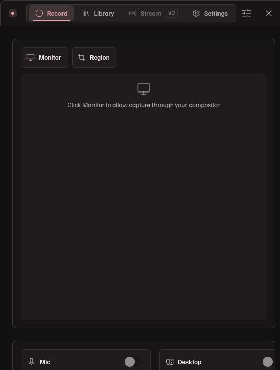
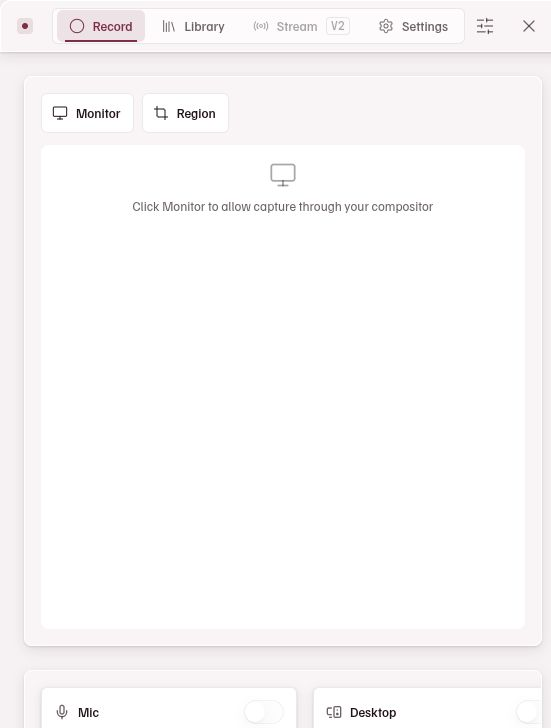
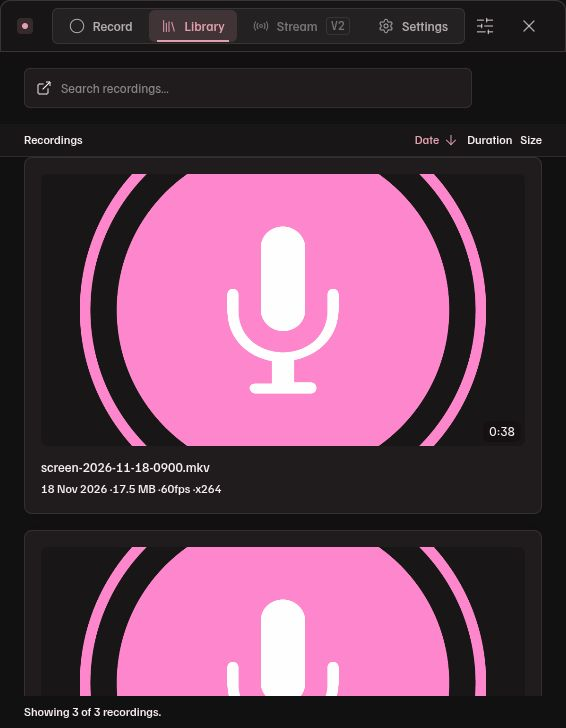

<p align="center">
  
</p>

# ScreenStudio Pro

**An open-source screen recording app for Wayland-first Linux — a frosted-glass alternative built for Hyprland, niri, MangoWC and KDE Plasma.**

> **Status: alpha (`0.0.1-alpha.1`).** The MVP recording pipeline and UI are implemented and CI-verified; distro packages are still being prepared. There is no published installer yet. See [release notes](docs/releases/0.0.1-alpha.1.md) for the honest capability matrix and known quirks.

## 📸 Screenshots

| Record (dark) | Record (light) |
|:---:|:---:|
|  |  |

| Settings (light) | Library |
|:---:|:---:|
|  |  |

> These are **UI previews** rendered from the Vite frontend with the Tauri IPC mocked; the Library preview uses sample rows. They show the shipped layout and v2 visual language, not a captured desktop recording session. Real in-app captures are still to be archived (task 7.6 residual).

## ✨ What works in this alpha

- **Wayland-native capture** — monitor/window/region selection via xdg-desktop-portal + PipeWire (window and region paths are implemented; live evidence is strongest on KDE Plasma — see [portal support](docs/portal-support.md)).
- **Audio recording** — mic + desktop channels with per-channel enable/mute/level, live post-gain meters, and graceful handling of a device disappearing mid-take.
- **Webcam PiP** — floating, draggable preview with corner snapping, size/shape controls, and optional self-insert compositing.
- **Floating recording HUD** — timer, pause/resume, stop and chapter flags, rendered in its own always-on-top window.
- **Recording library** — thumbnails, search, sort, detail drawer, soft delete and missing-file states, backed by a local SQLite index.
- **Session lifecycle** — tray quick actions, minimize-to-tray on record, and finalize-on-quit.
- **Files** — MKV takes with optional MP4 remux, strftime-style naming, plain-language quality presets.
- **v2 interface** — burgundy-on-near-black glass theme, square preview centered in a two-column workspace, full light mode, reduced-motion-aware motion, keyboard-reachable controls.

**Not in this alpha:** RTMP/live streaming, scene compositor, replay buffer, video editor, plugin API, and hardware-encoder acceleration (VAAPI/NVENC detection is currently a stub; x264 is the working fallback). These are PRD V2/Later items — see the roadmap in [PLAN.md](PLAN.md).

## 🧰 Requirements for building from source

- Linux on Wayland (KDE Plasma, Hyprland, niri, MangoWC) with PipeWire and an xdg-desktop-portal implementation.
- Rust stable (edition 2024), Node.js 22+, npm.
- System dev libraries: PipeWire (`libpipewire-0.3-dev`), ALSA (`libasound2-dev`), FFmpeg development headers, and the usual Tauri/WebKitGTK build dependencies. Exact names vary by distro; CI installs the Ubuntu equivalents.

## 🚀 Quick start (developers)

```bash
git clone https://github.com/zvirox/screen-studio-pro.git
cd screen-studio-pro
npm install
npm run tauri dev          # build the Rust core and open the Tauri window
```

Checks used by CI and before every commit:

```bash
npm run typecheck && npm run lint && npm test && npm run build
cd src-tauri && cargo fmt --check && cargo clippy --all-targets -- -D warnings && cargo test --lib
```

## 📦 Installing

No packages are published yet — packaging and the first tagged release are tracked as task 7.5. Once published, the intended channels are Flatpak, `.deb`, `.rpm`/AppImage via GitHub Releases, with AUR as a follow-up. See [release notes](docs/releases/0.0.1-alpha.1.md) for current status.

## 🌍 Environment variables

Runtime/debug overrides only; user settings live in the app and its TOML config (ARCHITECTURE §5.3):

| Name | Purpose | Example |
|---|---|---|
| `SSP_LOG_FILE` | Override the log file path | `~/ssp-debug.log` |
| `SSP_LOG_LEVEL` | Log verbosity (`trace`/`debug`/`info`/`warn`/`error`) | `debug` |
| `SSP_DATA_DIR` | Override recordings/library data directory | `~/Videos/SSP` |
| `SSP_CONFIG_DIR` | Override config directory | `~/.config/screen-studio-pro` |
| `SSP_FORCE_ENCODER` | Force an encoder backend for testing | `x264` |

## 📁 Repository layout

```
src-tauri/src/     Rust core: capture/, encode/, pipeline/, library/, ipc/, settings/
src/               React webview: components/{chrome,record,library,settings,huds,ui}/, hooks/, lib/, types/
src-tauri/sql/     numbered SQLite migrations
packaging/         Flatpak manifest (AUR/deb/rpm follow-up)
.github/workflows/ CI + tag-triggered release
docs/              portal-support.md, releases/, screenshots/
*.md               PRD, PRODUCT, DESIGN, ARCHITECTURE, DATABASE, API, PLAN, AGENTS
```

## 📜 Documentation

- [PRD.md](PRD.md) — scope, MVP/V2/Later, success metrics
- [DESIGN.md](DESIGN.md) — v2 visual law (tokens, components, layouts, a11y)
- [ARCHITECTURE.md](ARCHITECTURE.md), [DATABASE.md](DATABASE.md), [API.md](API.md) — structure, schema, IPC contract
- [PLAN.md](PLAN.md) — phased roadmap and evidence ledger
- [docs/portal-support.md](docs/portal-support.md) — per-compositor quirks and live evidence
- [REAOS.md](REAOS.md) — reverse-engineering study used to plan V2 work

## 🤝 Contributing

1. Read [AGENTS.md](AGENTS.md) first — workflow, source-of-truth priority and hard limits (no stack changes, no new dependencies without approval, schema changes require DATABASE.md first).
2. Contract files are law: a conflicting request is a contract change, not a code change.
3. Small, verified changes with real command output; pause between delivered tasks.
4. Wayland bug reports should include compositor + version, PipeWire/portal versions, GPU and driver — that data drives `docs/portal-support.md`.

## 📜 License

[MIT](LICENSE) © 2026 Zvirox
