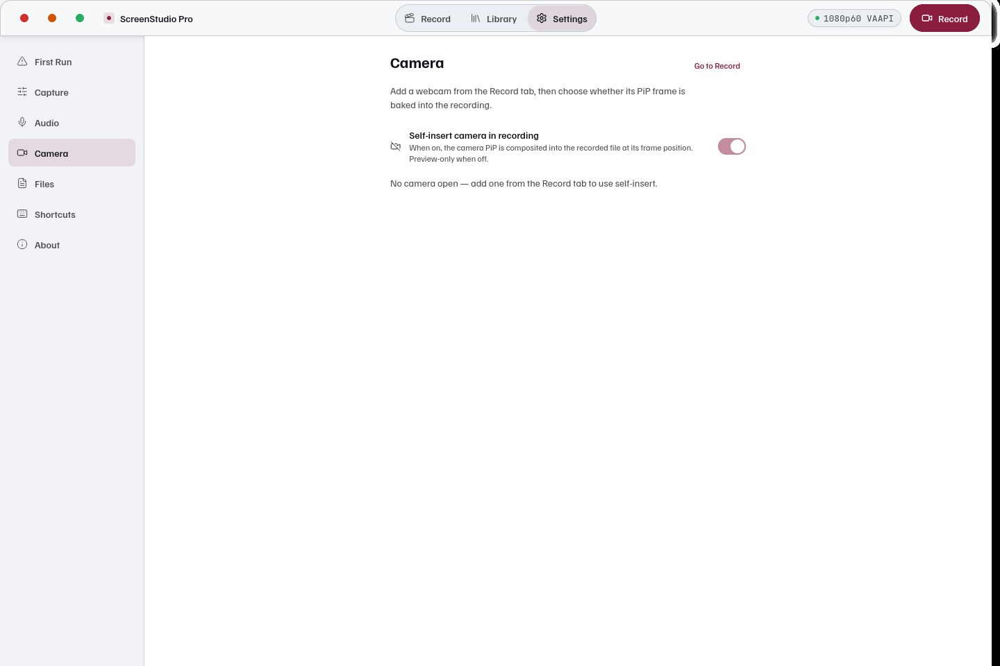

<p align="center">
  
</p>

# Screen Studio Pro

**An open-source screen recording app for Wayland-first Linux — a frosted-glass alternative built for Hyprland, niri, MangoWC and KDE Plasma.**

> **Status: alpha (`0.1.0`, release tag `v0.1.0`).** Phases 0–6 and all seven v3 studio UI stages are implemented; the recording pipeline and local library are CI-verified. Release CI builds and attaches native package formats (.deb, .rpm, .pkg.tar.zst). See the [capability matrix and known quirks](docs/releases/0.0.1-alpha.8.md) and [full progress ledger](PLAN.md).

## 📸 Screenshots

|                         Record (dark)                         |                         Record (light)                          |
| :-----------------------------------------------------------: | :-------------------------------------------------------------: |
|  |  |

|                    Settings (light)                    |                        Library                         |
| :----------------------------------------------------: | :----------------------------------------------------: |
|  |  |

> These are **UI previews** rendered from the Vite frontend with the Tauri IPC mocked; the Library preview uses sample rows. They show the current v3.2 layout and visual language, not a captured desktop recording session. Real in-app captures are still to be archived (task 7.6 residual).

## ✨ What works in this alpha

- **Wayland-native capture** — monitor/window/region selection via xdg-desktop-portal + PipeWire (window and region paths are implemented; live evidence is strongest on KDE Plasma — see [portal support](docs/portal-support.md)).
- **Audio recording** — mic + desktop channels with per-channel enable/mute/level, live post-gain meters, and graceful handling of a device disappearing mid-take.
- **Webcam PiP** — floating, draggable preview with corner snapping, size/shape controls, and optional self-insert compositing.
- **Floating recording HUD** — timer, pause/resume, stop and chapter flags, rendered in its own always-on-top window.
- **Recording library** — thumbnails, search, sort, detail drawer, soft delete and missing-file states, backed by a local SQLite index.
- **Session lifecycle** — tray quick actions, minimize-to-tray on record, and finalize-on-quit.
- **Files** — MKV takes with optional MP4 remux, strftime-style naming, plain-language quality presets.
- **v3 studio interface** — responsive floating-island layout (DESIGN.md v3.2): left capture-inspector, 16:9 hero preview canvas, sub-canvas audio mixer, and takes/presets gallery; integrated studio titlebar; full light mode, reduced-motion-aware motion, keyboard-reachable controls.

**Not in this alpha:** RTMP/live streaming, scene compositor, replay buffer, video editor, plugin API, and hardware-encoder acceleration (VAAPI/NVENC detection is currently a stub; x264 is the working fallback). These are PRD V2/Later items — see the roadmap in [PLAN.md](PLAN.md).

## 🧰 Requirements for building from source

- Linux on Wayland (KDE Plasma, Hyprland, niri, MangoWC) with PipeWire and an xdg-desktop-portal implementation.
- Rust stable (edition 2024), Node.js 22+, npm.
- System dev libraries: PipeWire (`libpipewire-0.3-dev`), ALSA (`libasound2-dev`), FFmpeg development headers, and the usual Tauri/WebKitGTK build dependencies. Exact names vary by distro; CI installs the Ubuntu equivalents.

## 🚀 Quick start (developers)

```bash
git clone https://github.com/zvirox/screen-studio-pro.git
cd screen-studio-pro
npm ci
npm run tauri dev          # build the Rust core and open the Tauri window
```

Checks used by CI and before every commit:

```bash
npm run typecheck && npm run lint && npm test && npm run build
cd src-tauri && cargo fmt --check && cargo clippy --all-targets -- -D warnings && cargo test --lib
```

## 📦 Installation

Download the appropriate package and `SHA256SUMS` from the [Latest Release](https://github.com/zvirox/screen-studio-pro/releases/latest).

### Debian / Ubuntu (`.deb`)

```bash
sudo apt install ./screen-studio-pro_<version>_amd64.deb
```

### Fedora / RHEL (`.rpm`)

```bash
sudo dnf install ./screen-studio-pro-<version>-1.x86_64.rpm
```

### Arch Linux / Manjaro (`.pkg.tar.zst`)

```bash
sudo pacman -U ./screen-studio-pro-<version>-1-x86_64.pkg.tar.zst
```

### Verify Checksums

Verify file integrity against the release manifest:

```bash
sha256sum -c SHA256SUMS --ignore-missing
```

> [!NOTE]
> **Packaging Update:** AppImage, Flatpak, and AUR builds are retired in favor of native packages (`.deb`, `.rpm`, `.pkg.tar.zst`).

Launch **Screen Studio Pro** from your application launcher or run `screen-studio-pro`. Select a monitor/window/region, approve the desktop portal's consent dialog, then select **Record**.

## 🌍 Environment variables

Runtime/debug overrides only; user settings live in the app and its TOML config (ARCHITECTURE §5.3):

| Name                | Purpose                                               | Example                            |
| ------------------- | ----------------------------------------------------- | ---------------------------------- |
| `SSP_LOG_FILE`      | Override the log file path                            | `~/ssp-debug.log`                  |
| `SSP_LOG_LEVEL`     | Log verbosity (`trace`/`debug`/`info`/`warn`/`error`) | `debug`                            |
| `SSP_DATA_DIR`      | Override the library database directory               | `~/.local/share/screen-studio-pro` |
| `SSP_CONFIG_DIR`    | Override config directory                             | `~/.config/screen-studio-pro`      |
| `SSP_FORCE_ENCODER` | Force an encoder backend for testing                  | `x264`                             |

## FAQ

### Which desktops have been tested?

Live capture evidence is primarily from **KDE Plasma 6 on Wayland**: monitor and window selection, audio, pause/resume, chapter flags and tray actions have observed runs there. Hyprland, niri and MangoWC are target desktops, but their sections in the [portal support matrix](docs/portal-support.md) do not yet contain live capture observations. Region capture, webcam self-insert and unfocused global-shortcut activation still rely mainly on automated evidence.

### Does alpha.6 use VAAPI or NVENC?

No. Hardware encoding is not implemented in this release; `auto` falls through to **x264 software encoding**. The VAAPI/NVENC selection helpers return unavailable, so forcing either backend does not enable hardware acceleration.

### Where are recordings and app data stored?

- Recordings: `~/Videos/SSP` by default (`$XDG_VIDEOS_HOME/SSP` when set), configurable under **Settings → Files**.
- Settings: `${XDG_CONFIG_HOME:-~/.config}/screen-studio-pro/settings.toml`.
- Library database and thumbnails: `${XDG_DATA_HOME:-~/.local/share}/screen-studio-pro/`.
- Logs: daily-rotated files under `${XDG_STATE_HOME:-~/.local/state}/screen-studio-pro/`.

The `SSP_CONFIG_DIR` and `SSP_DATA_DIR` overrides replace the corresponding XDG locations. Recording files remain local; the library database is an index, not a copy of the videos.

### Does the recording contain separate mic and desktop tracks?

No. Enabled mic and desktop inputs are mixed into **one stereo AAC track** alongside the H.264 video. Discrete multitrack recording is planned for a later release.

### MKV or MP4?

Recording starts as MKV. The default Files setting requests an MP4 remux on stop, using `ffmpeg -c copy` rather than re-encoding; the MKV is preserved if remux fails. Select MKV in Files settings to skip that step.

### Why does the portal ask for permission again?

Capture grants are reused only within the current app run. Restarting the app can show the consent dialog again. If you cancel it, select the source again to retry; an unanswered dialog times out after two minutes.

## Troubleshooting

### No consent dialog, preview or capture stream

Confirm a Wayland session and check the portal/PipeWire services while reproducing the problem:

```bash
printf 'desktop=%s session=%s\n' "$XDG_CURRENT_DESKTOP" "$XDG_SESSION_TYPE"
systemctl --user --no-pager status pipewire xdg-desktop-portal
journalctl --user -u xdg-desktop-portal -b --no-pager
```

Install/enable your compositor's `xdg-desktop-portal` backend if it is missing, then retry source selection. Window capture is currently exposed only when `XDG_CURRENT_DESKTOP` identifies KDE/Plasma. For `capture.no_frames` or a stream that disappears, release and select the source again; compositor-specific negotiation notes are in [portal support](docs/portal-support.md).

### Microphone or desktop audio is unavailable

Check that PipeWire is running, select another device in Audio settings, or disable the failing channel. A device that disappears during a take is reported and that channel becomes silent while recording continues; start-time failures require reconnecting/replacing the device or disabling that channel. If another recording application holds the microphone exclusively, close it and retry.

### MP4 remux fails

The native build invokes the `ffmpeg` executable on `PATH`. Install your distro's FFmpeg package, or choose MKV output in Files settings. The original MKV is kept after a failed remux. `ffprobe` can check the resulting file:

```bash
ffprobe -v error -show_entries stream=codec_name,codec_type -of default=noprint_wrappers=1 /path/to/take.mkv
```

### Recording or settings paths are unwritable

For `disk.path_unwritable`, choose a writable output directory under **Settings → Files** and check free space. If `settings.toml` is invalid or from an incompatible schema, close the app and rename it to keep a backup; the next launch creates defaults:

```bash
mv "${XDG_CONFIG_HOME:-$HOME/.config}/screen-studio-pro/settings.toml" \
  "${XDG_CONFIG_HOME:-$HOME/.config}/screen-studio-pro/settings.toml.bak"
```

### Collect debug logs

For a native package install, this starts the app with debug logging to a known file:

```bash
SSP_LOG_LEVEL=debug SSP_LOG_FILE="$HOME/ssp-debug.log" screen-studio-pro
```

Otherwise, find the rotated logs with:

```bash
ls -lt "${XDG_STATE_HOME:-$HOME/.local/state}/screen-studio-pro"/screen-studio-pro.log*
```

When [filing a bug](https://github.com/zvirox/screen-studio-pro/issues/new?template=bug_report.yml), include the exact release/package, compositor and version, PipeWire and portal backend versions, GPU/driver, reproduction steps and relevant log lines. Redact personal paths or device names before posting.

## 📁 Repository layout

```
src-tauri/src/     Rust core: capture/, encode/, pipeline/, library/, ipc/, settings/
src/               React webview: components/{chrome,record,library,settings,huds,ui}/, hooks/, lib/, types/
src-tauri/sql/     numbered SQLite migrations
packaging/         Linux packaging configs (nfpm.yaml, desktop, icons)
.github/workflows/ CI + tag-triggered release
docs/              portal-support.md, releases/, screenshots/
*.md               PRD, PRODUCT, DESIGN, ARCHITECTURE, DATABASE, API, PLAN, AGENTS
```

## 📜 Documentation

- [PRD.md](PRD.md) — scope, MVP/V2/Later, success metrics
- [DESIGN.md](DESIGN.md) — v3 visual law (tokens, components, layouts, a11y)
- [ARCHITECTURE.md](ARCHITECTURE.md), [DATABASE.md](DATABASE.md), [API.md](API.md) — structure, schema, IPC contract
- [PLAN.md](PLAN.md) — phased roadmap and evidence ledger
- [docs/portal-support.md](docs/portal-support.md) — per-compositor quirks and live evidence
- [REAOS.md](REAOS.md) — reverse-engineering study used to plan V2 work

## 🤝 Contributing

1. Read [AGENTS.md](AGENTS.md) first — workflow, source-of-truth priority and hard limits (no stack changes, no new dependencies without approval, schema changes require DATABASE.md first).
2. Contract files are law: a conflicting request is a contract change, not a code change.
3. Small, verified changes with real command output; pause between delivered tasks.
4. Wayland bug reports should include compositor + version, PipeWire/portal versions, GPU and driver — that data drives `docs/portal-support.md`.

## 📜 License

[MIT](LICENSE) © 2026 Zvirox
