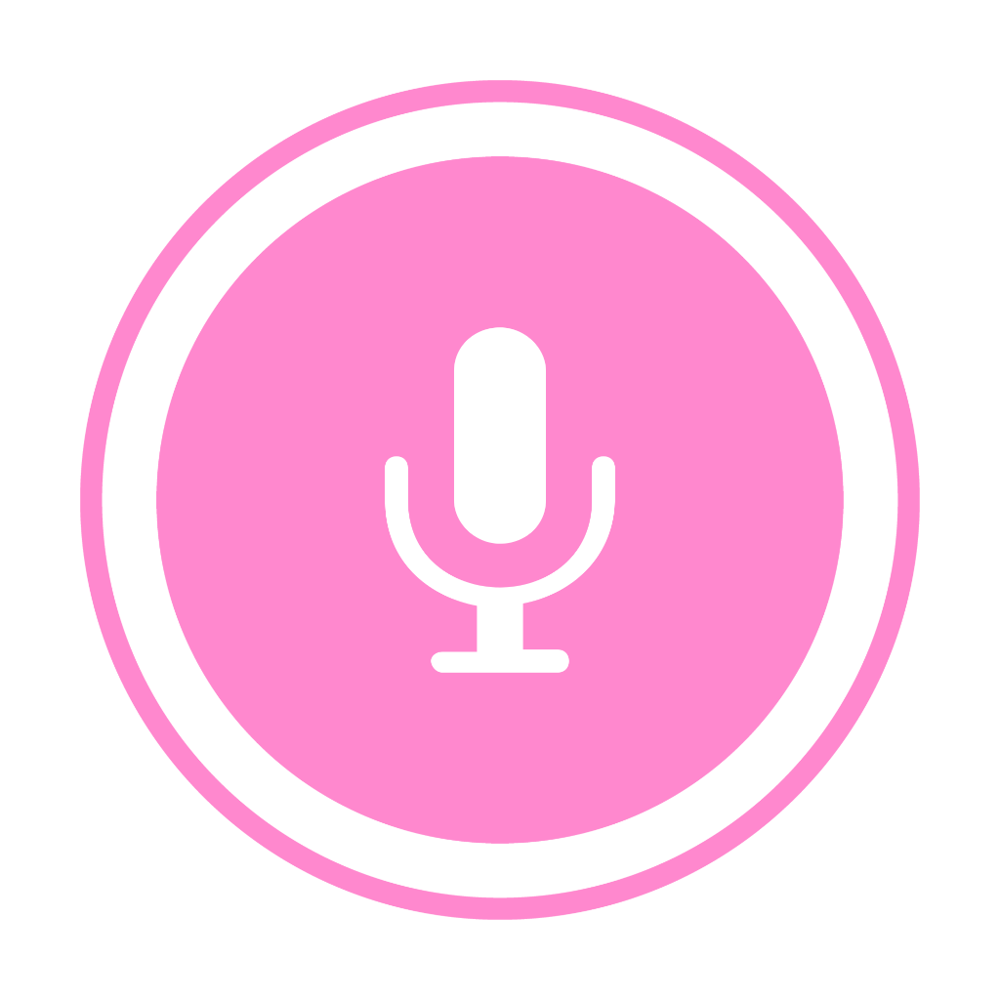
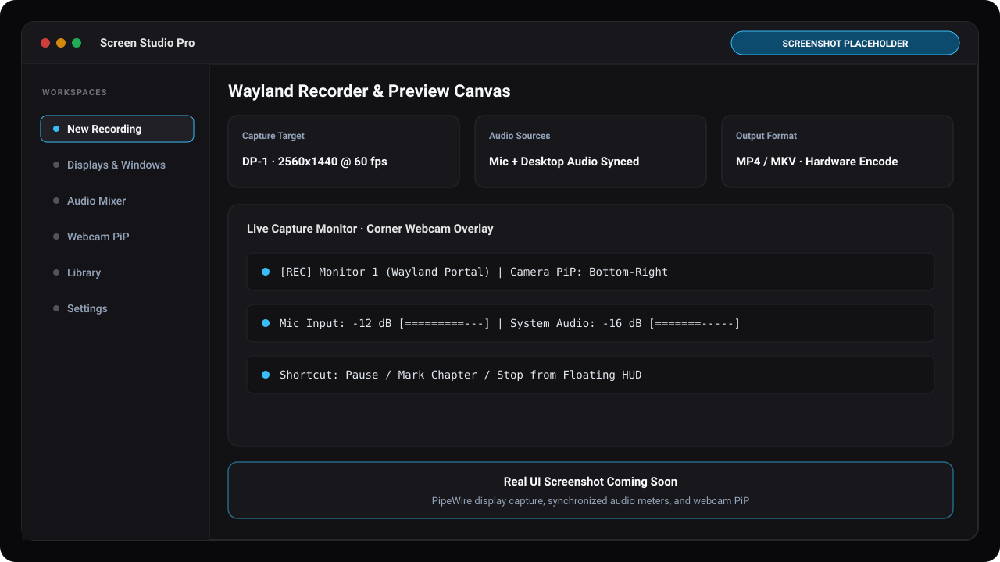
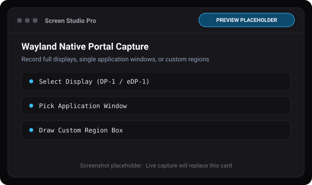
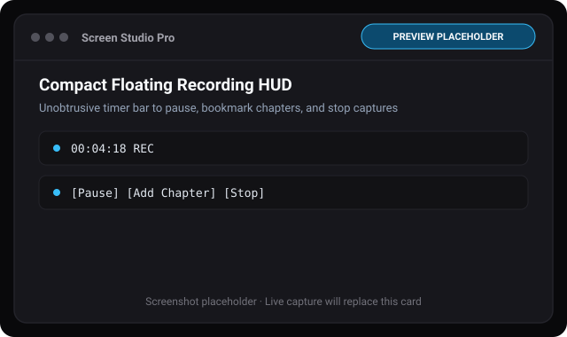
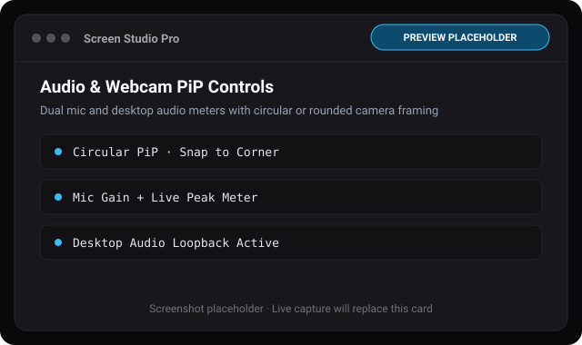
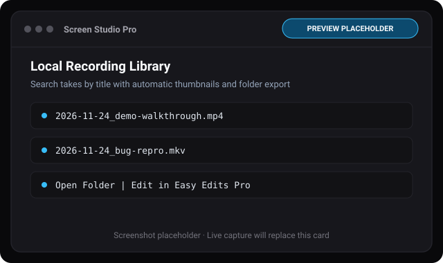
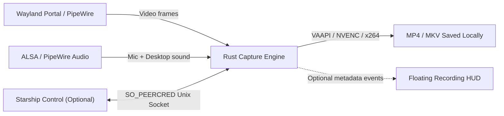

<div align="center">
  <a id="top"></a>
  <p>
    
  </p>

  <h1>Screen Studio Pro</h1>

  <h3>Clean, fast screen recording built natively for Linux desktops</h3>

  <p>
    Capture monitors, app windows, custom regions, synced audio, and webcam PiP on Wayland and X11 with zero telemetry.
  </p>

  <p>
    <a href="https://zvirox.in/projects/ssp/">Project Page</a> ·
    <a href="https://zvirox.in/downloads/ssp/">Download Packages</a> ·
    <a href="https://github.com/zvirox/screen-studio-pro/releases">GitHub Releases</a> ·
    <a href="#quick-installation">Quick Install</a> ·
    <a href="#key-features">Features</a> ·
    <a href="#starship-control-integration">Starship Control</a> ·
    <a href="#maintainer-and-ecosystem">Maintainer</a> ·
    <a href="#frequently-asked-questions">FAQ</a>
  </p>

  <p>
    <a href="https://zvirox.in/downloads/ssp/">
      
    </a>
    <a href="https://github.com/zvirox/screen-studio-pro/actions/workflows/ci.yml">
      
    </a>
    <a href="LICENSE">
      
    </a>
    
    
  </p>

  <table>
    <tr>
      <td align="right"><b>Start</b></td>
      <td align="center"><a href="#what-is-screen-studio-pro">What It Is</a></td>
      <td align="center"><a href="#workspace-previews">Previews</a></td>
      <td align="center"><a href="#quick-installation">Install</a></td>
    </tr>
    <tr>
      <td align="right"><b>Features</b></td>
      <td align="center"><a href="#key-features">Key Capabilities</a></td>
      <td align="center"><a href="#how-capture-works">How Capture Works</a></td>
      <td align="center"><a href="#tech-stack">Tech Stack</a></td>
    </tr>
    <tr>
      <td align="right"><b>Automation</b></td>
      <td align="center"><a href="#starship-control-integration">Starship Control</a></td>
      <td align="center"><a href="#real-world-use-cases">Use Cases</a></td>
      <td align="center"><a href="#how-connection-works">Socket Setup</a></td>
    </tr>
    <tr>
      <td align="right"><b>Community</b></td>
      <td align="center"><a href="#frequently-asked-questions">FAQ</a></td>
      <td align="center"><a href="#maintainer-and-ecosystem">Maintainer</a></td>
      <td align="center"><a href="#license">License</a></td>
    </tr>
  </table>
</div>

<br />

<p align="center">
  
  <br />
  <sub><b>Screenshot placeholder.</b> Main Screen Studio Pro studio showing PipeWire monitor selection, webcam PiP, and live audio meters.</sub>
</p>

---

## What is Screen Studio Pro?

Most Linux screen recorders feel overwhelming when you just want to record a clean software demo, bug report, or tutorial. Complex scene trees and streaming menus get in the way of pressing record.

Screen Studio Pro gives Wayland and X11 users a focused recording studio built in Rust and React. Pick an entire monitor, a single window, or a custom region through native Linux portals, balance your microphone and desktop audio, add a webcam bubble, and save crisp MP4 or MKV videos straight to your Videos folder.

It works 100% locally with zero user accounts, zero cloud uploads, and zero background tracking.

---

## Workspace Previews

<table>
  <tr>
    <td width="50%" valign="top">
      <br />
      <strong>Wayland Native Portal Capture</strong><br />
      Works cleanly on Hyprland, niri, KDE Plasma, GNOME, and X11 to grab monitors, single windows, or custom boxes.
    </td>
    <td width="50%" valign="top">
      <br />
      <strong>Floating Recording HUD</strong><br />
      A small always-ready pill lets you pause, drop chapter markers during long takes, and stop without cluttering your screen.
    </td>
  </tr>
  <tr>
    <td width="50%" valign="top">
      <br />
      <strong>Synced Audio and Webcam PiP</strong><br />
      Record microphone and desktop sound together with live gain meters while floating a circular or rounded camera overlay.
    </td>
    <td width="50%" valign="top">
      <br />
      <strong>Built-in Recording Library</strong><br />
      Browse past takes with automatic thumbnails, search recordings by name, and send finished clips straight into Easy Edits Pro.
    </td>
  </tr>
</table>

---

## Key Features

- **Wayland and X11 Ready**: Built around PipeWire and XDG Desktop Portals so screen capture works smoothly on Hyprland, KDE Plasma, GNOME, niri, MangoWC, and traditional X11 desktops.
- **Hardware Encoding Options**: Supports VAAPI, NVENC, and software x264 encoding so recordings stay smooth without bogging down your processor.
- **Dual-Channel Audio**: Capture your microphone alongside system desktop audio with real-time level meters to avoid clipping before you start.
- **Flexible Webcam Overlay**: Snap your camera feed to any screen corner, resize it freely, and switch between circular and rounded-rectangle frames.
- **MKV Safety With MP4 Output**: Records reliably and handles clean MKV-to-MP4 remuxing so finished files open everywhere.
- **Clean Matte Dark Design**: Built with solid dark graphite surfaces, 1px borders, high contrast typography, and full keyboard accessibility.

---

## How Capture Works

Screen Studio Pro separates the user interface from the recording pipeline so video frames never slow down your window controls.



| Capability | Supported Scope | Notes |
| :--- | :--- | :--- |
| **Capture Sources** | Full Monitor, Application Window, Custom Region | Selected through Linux XDG Portals |
| **Compositors** | Hyprland, niri, MangoWC, KDE Plasma, GNOME, X11 | PipeWire native capture |
| **Encoders** | VAAPI, NVENC, x264 | Picked automatically or in Settings |
| **Audio Inputs** | Microphone + System Loopback | Live gain sliders and meters |
| **Outputs** | MKV and MP4 | Saved to `~/Videos/Screen Studio Pro` |

---

## Starship Control Integration

Screen Studio Pro works completely on its own as a standalone recording program. You do not need any companion software to record and export videos.

If you want hands-free automation, Screen Studio Pro connects automatically with [Starship Control](https://github.com/zvirox/starship-control) ([Releases](https://github.com/zvirox/starship-control/releases)), the optional Linux AI desktop assistant.

### Why It Exists

When you are presenting slides, live coding, or demonstrating an app, switching windows to click record breaks your flow. Pairing Screen Studio Pro with Starship Control lets you start, pause, mark chapters, and hand footage off to an editor using plain voice or keyboard prompts.

### Real-World Use Cases

- **Hands-Free Start and Stop**: Ask *"Start recording my primary monitor with webcam overlay"* without opening menus.
- **One-Prompt Editing Handoff**: Tell Starship Control *"Take a 60-second recording and open it in Easy Edits Pro so I can trim out silent pauses."*
- **Chapter Marking While Speaking**: Summon the Floating HUD with `Super+Shift+Space` and ask it to tag key moments while you record tutorials.

### How Connection Works

Setup happens automatically when you launch both apps:

1. **Local Discovery**: Screen Studio Pro writes a small plugin descriptor to `$XDG_DATA_HOME/starship/plugins/ssp.json`.
2. **Private Unix Socket**: Commands flow through `$XDG_RUNTIME_DIR/starship/bridges/ssp.sock` on your local disk.
3. **Kernel User Verification**: Every message checks Linux peer credentials (`SO_PEERCRED`). Only processes running as your user account can control the recorder. Zero network ports open.
4. **Instant Detection**: Open Starship Control or press `Super+Shift+Space` to start commanding Screen Studio Pro immediately. For downloads and setup details, visit the [Starship Control repository](https://github.com/zvirox/starship-control) and [releases](https://github.com/zvirox/starship-control/releases).

---

## Quick Installation

Prebuilt Linux packages and checksum files are available on the [Releases page](https://github.com/zvirox/screen-studio-pro/releases).

| Distribution | Package Format | Install Command |
| :--- | :--- | :--- |
| **Debian / Ubuntu / Pop!_OS / Mint** | `.deb` | `sudo apt install ./screen-studio-pro_*_amd64.deb` |
| **Fedora / RHEL / openSUSE** | `.rpm` | `sudo dnf install ./screen-studio-pro-*.x86_64.rpm` |
| **Arch Linux / Manjaro / CachyOS** | `.pkg.tar.zst` | `sudo pacman -U ./screen-studio-pro-*-x86_64.pkg.tar.zst` |

<details>
<summary><strong>Verify Checksums and Build From Source</strong></summary>

Verify downloaded files using `SHA256SUMS`:

```bash
sha256sum -c SHA256SUMS --ignore-missing
```

To build from source, install Rust stable, Node.js 22+, and development packages for PipeWire (`libpipewire-0.3-dev`), ALSA (`libasound2-dev`), FFmpeg libraries (`libavcodec-dev`, `libavformat-dev`, `libavutil-dev`, `libswscale-dev`, `libswresample-dev`), and WebKitGTK (`libwebkit2gtk-4.1-dev`):

```bash
git clone https://github.com/zvirox/screen-studio-pro.git
cd screen-studio-pro
npm install
npm run tauri build
```

</details>

Official Linux releases ship exclusively as native `.deb`, `.rpm`, and `.pkg.tar.zst` packages alongside `SHA256SUMS`. Legacy AppImage, Flatpak, tarball, and AUR packages are retired and no longer updated.

---

## Tech Stack

| Layer | Technology | Role |
| :--- | :--- | :--- |
| **Capture Core** | Rust + PipeWire + Portal APIs | Display, window, audio, and webcam capture pipeline |
| **Desktop Shell** | Tauri 2 | Native Linux windowing, tray controls, and Recording HUD |
| **Frontend UI** | React 19 + TypeScript + Tailwind CSS v4 | Matte dark interface, meters, and recording library |
| **Telemetry & Charts** | Apache ECharts 6 + Zustand | Performance charts and responsive state updates |
| **Automation Bridge** | `starship-plugin` SDK | Local Unix socket integration with Starship Control |

---

## Frequently Asked Questions

**Does Screen Studio Pro work on both Wayland and X11?**
Yes. It uses Wayland desktop portals and PipeWire by default, and supports X11 desktops smoothly as well.

**Do I have to install Starship Control to record videos?**
No. Screen Studio Pro is a standalone desktop recorder with full window and hotkey controls. Starship Control is an optional companion if you want natural-language commands and multi-app automation.

**Where are finished recordings saved?**
Recordings save locally to a `Screen Studio Pro` folder inside your user Videos directory. You can pick any custom folder in Settings.

**Does the app collect analytics or require sign-in?**
No. There are zero user accounts, subscriptions, cloud servers, or telemetry connections.

---

## Maintainer and Ecosystem

<p align="center">
  <a href="https://www.zvirox.in">
    
  </a>
</p>

<p align="center">
  <strong>Prakashpuri Gauswami (<a href="https://github.com/zvirox">@zvirox</a>)</strong><br />
  Cybersecurity Analyst &amp; SOC Practitioner · Agentic AI Builder · Blue Team &amp; SIEM · Patan, Gujarat, India
</p>

<p align="center">
  <a href="https://github.com/sponsors/zvirox">
    
  </a>
  <a href="https://ko-fi.com/zvirox">
    
  </a>
</p>

I build local-first open-source Linux and Android tools under **Zvirox**. Writing real software helps me study system boundaries and security architecture hands-on while giving creators and Linux users fast desktop tools free from subscriptions and telemetry.

### Connect and Support

- **GitHub Profile**: [github.com/zvirox](https://github.com/zvirox)
- **Website**: [www.zvirox.in](https://www.zvirox.in)
- **Email**: [info@zvirox.in](mailto:info@zvirox.in)
- **Sponsor**: [GitHub Sponsors](https://github.com/sponsors/zvirox) · [Ko-fi](https://ko-fi.com/zvirox)
- **Socials**: [LinkedIn (`in/plgsevala`)](https://www.linkedin.com/in/plgsevala) · [YouTube (`@zvirox_in`)](https://www.youtube.com/@zvirox_in) · [Instagram (`plg.sevala`)](https://www.instagram.com/plg.sevala) · [Facebook (`plg.sevala`)](https://www.facebook.com/plg.sevala)

### Zvirox App Suite (Open-Source Project List)

All six applications in the Zvirox desktop suite work standalone and connect together through Starship Control:

| Logo | Application | Purpose | Repository | Download & Project |
| :---: | :--- | :--- | :--- | :--- |
|  | **[Starship Control](https://zvirox.in/projects/sc/)** | Local-first AI desktop cockpit and floating HUD | [github.com/zvirox/starship-control](https://github.com/zvirox/starship-control) | [Download](https://zvirox.in/downloads/sc/) · [Releases](https://github.com/zvirox/starship-control/releases) |
|  | **[Screen Studio Pro](https://zvirox.in/projects/ssp/)** | Wayland and X11 screen recorder with PipeWire | [github.com/zvirox/screen-studio-pro](https://github.com/zvirox/screen-studio-pro) | [Download](https://zvirox.in/downloads/ssp/) · [Releases](https://github.com/zvirox/screen-studio-pro/releases) |
|  | **[Easy Edits Pro](https://zvirox.in/projects/eep/)** | Non-destructive multitrack video editor | [github.com/zvirox/easy-edits-pro](https://github.com/zvirox/easy-edits-pro) | [Download](https://zvirox.in/downloads/eep/) · [Releases](https://github.com/zvirox/easy-edits-pro/releases) |
|  | **[Audio Labs Pro](https://zvirox.in/projects/alp/)** | Offline voice studio and multitrack audio editor | [github.com/zvirox/audio-labs-pro](https://github.com/zvirox/audio-labs-pro) | [Download](https://zvirox.in/downloads/alp/) · [Releases](https://github.com/zvirox/audio-labs-pro/releases) |
|  | **[Agentic Tuneup Pro](https://zvirox.in/projects/atp/)** | Safety-first disk cleaner and system optimizer | [github.com/zvirox/agentic-tuneup-pro](https://github.com/zvirox/agentic-tuneup-pro) | [Download](https://zvirox.in/downloads/atp/) · [Releases](https://github.com/zvirox/agentic-tuneup-pro/releases) |
|  | **[Net Watch Pro](https://zvirox.in/projects/nwp/)** | Real-time network speed and per-app data tracker | [github.com/zvirox/net-watch-pro](https://github.com/zvirox/net-watch-pro) | [Download](https://zvirox.in/downloads/nwp/) · [Releases](https://github.com/zvirox/net-watch-pro/releases) |
| - | **[Your TV Friend](https://zvirox.in/projects/ytf/)** | Android TV non-destructive debloater and Your UI launcher | [github.com/zvirox/your-tv-friend](https://github.com/zvirox/your-tv-friend) | [Download APK](https://zvirox.in/downloads/ytf/) · [Releases](https://github.com/zvirox/your-tv-friend/releases) |

---

## Star History

<p align="center">
  <a href="https://www.star-history.com/#zvirox/screen-studio-pro&Date">
    <picture>
      <source media="(prefers-color-scheme: dark)" srcset="https://api.star-history.com/svg?repos=zvirox/screen-studio-pro&type=Date&theme=dark" />
      <source media="(prefers-color-scheme: light)" srcset="https://api.star-history.com/svg?repos=zvirox/screen-studio-pro&type=Date" />
      
    </picture>
  </a>
</p>

---

## License

Screen Studio Pro is free, open-source software licensed under the [MIT License](LICENSE).

<div align="center">
  <br />
  <a href="#top"><strong>Back to top</strong></a> · Built in public by <a href="https://www.zvirox.in">Zvirox</a>
</div>
