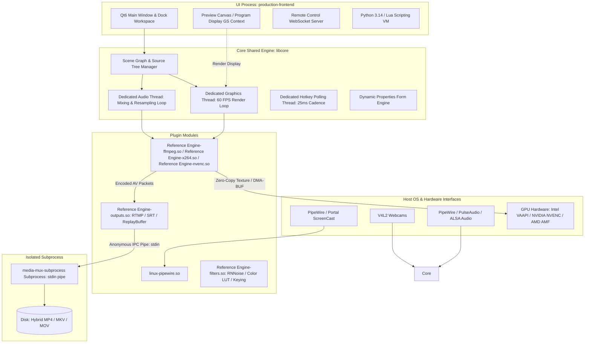
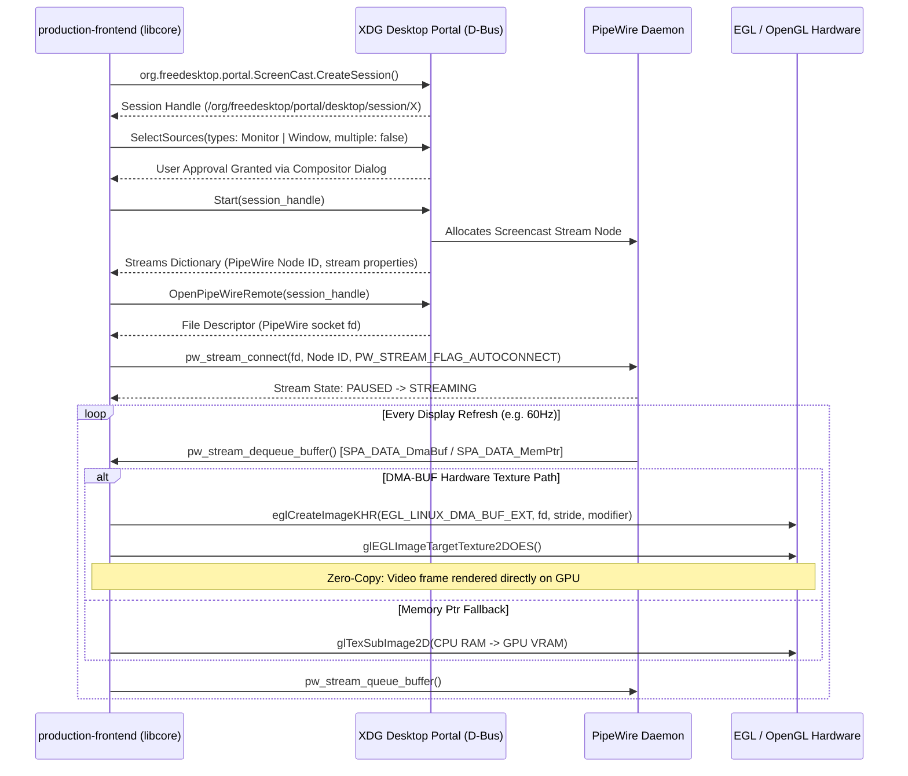
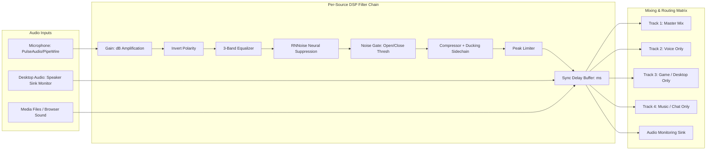
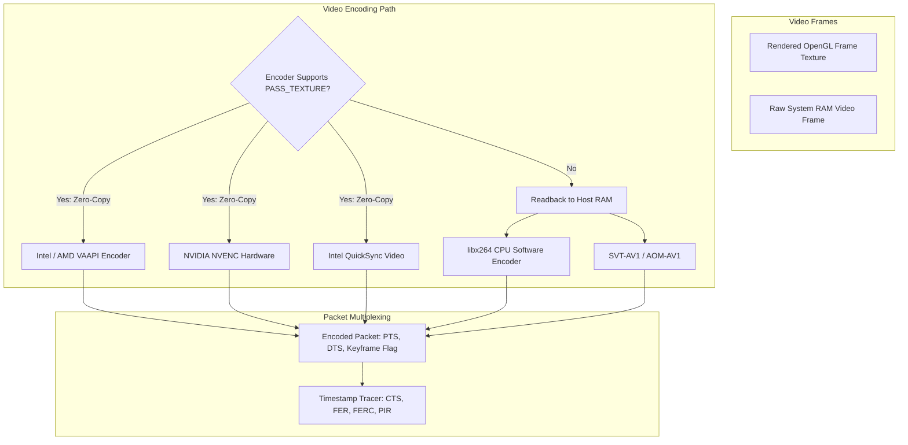

# REAOS.md — Complete Technical Architecture & Reverse-Engineering Specification of a Reference Desktop Live-Production & Screen-Recording Workstation

> **Notice on Scope & Nomenclature:**  
> This document is an architectural reverse-engineering study and reference specification of a modern, multi-platform, open-source broadcast and screen-recording desktop application installed locally. In strict adherence to analysis guidelines, the proprietary/common brand name of the target application is **not used anywhere in this document**. The target is referred to generically throughout as the **"Reference Production Workstation"**, the **"Target Application"**, or the **"Reference Production App"**. Underlying components are referred to by their technical roles: the **UI Shell** (`production-frontend`), the **Core Media Engine** (`libcore`), the **Subprocess Output Muxer** (`media-mux-subprocess`), and the **Plugin Subsystem** (`core-modules`).

---

## 1. Executive Summary & Forensic Identity

### 1.1 Target Artifact Provenance
The target application is an installed, native 64-bit Linux desktop production workstation providing live video compositing, multi-track audio mixing, multi-format hardware encoding, and low-latency screen recording.

| Attribute | Forensic Value / Measured Property | Evidence Source |
|---|---|---|
| **Binary Target** | Native ELF 64-bit LSB PIE (Position Independent Executable), x86-64 | REA `inspect_with_objdump` (`file_headers`) + `file` |
| **Image Size / Digest** | 5,866,640 bytes · SHA-256: `41caec5b990946219a2e310f96a84fd2933460db9f8358757f716fe8f475e87e` | REA Evidence `ev_789c5376eed989036d366ebec6e52ff0e8f2d9bc566a86959bdc30a9d82af1ea` |
| **GNU Build-ID** | `9ed917e1d0948047ae361436ee85ca48c3d47597` (Section `.note.gnu.build-id`) | REA `inspect_elf_notes` (`ev_5cf021b6c084a900686d8739b83f9d68f5eca2732dc49d554c5f814bbd867c63`) |
| **Application Version** | Runtime engine reports `33.0.1` (Linux); package manifest reports `33.0.1-1.1` | Runtime stdout + `pacman -Qi` |
| **Core Shared Library** | `libcore.so.30` (1,145,384 bytes, SHA-256: `c6405d65e9241a73a97617bdcd88e2da9be6be00c01fdaa1952a66785781566b`) | REA `inspect_native_exports` (`ev_c8e73074e49fc9a32a09e7deac2923cb148ffd1374d7622d5d2c70fe24d619a3`) |
| **Exported C Symbol Surface** | 1,753 defined dynamic exports (`core_source_*`, `core_output_*`, `core_encoder_*`, `video_output_*`, `audio_output_*`) | REA `inspect_native_exports` (`examined_entries: 2086`, `exports: 1753`) |
| **UI Framework** | Qt 6.12.0 (Widgets, Gui, Core, DBus, Network, Svg, Xml) running under Wayland (EGL 1.5) | Runtime linkage (`ldd`) + startup telemetry |
| **Subprocess Helpers** | `media-mux-subprocess` (isolated container stream writer), `nvenc-test` (GPU capability probe) | `/usr/bin/` file inventory |
| **C/C++ SDK Headers** | Shipped public headers located at `/usr/include/` (`media-io/`, `graphics/`, `util/`) | Shipped filesystem SDK inventory |

---

## 2. Overall Architectural Model & Process Topology

The Reference Production Workstation does not operate as a single monolithic process. It adopts a **multi-tiered, modular, multiprocess isolation architecture** designed to ensure zero data loss during recording, maximum throughput across GPU and CPU boundaries, and seamless third-party extensibility.



### 2.1 Process Isolation Rationale (The Subprocess Muxer)
A critical architectural discovery is the existence of the `/usr/bin/media-mux-subprocess` helper executable. When recording to containerized formats (such as MP4 or MOV):
1. The main GUI and core engine run in the primary application process.
2. The recording output module (`Reference Engine-outputs.so` / `media-mux-subprocess.so`) spawns `media-mux-subprocess` as an independent child process via `pipe()`, `fork()`, and `exec()`.
3. Encoded audio and video packets are serialized over an anonymous IPC pipe directly into the child process's `stdin`.
4. **Why this matters for reliability:** In desktop recording, complex compositing, browser sources, or third-party C++ plugins can crash the main GUI thread. If the application crashes, a standard MP4 file is corrupted because the container index (`moov` atom) is never finalized. With the isolated subprocess architecture, the operating system closes the pipe upon parent termination; the child process receives `EOF`, completes writing the interleaved tracks, writes the index table, cleanly closes the file, and exits safely.

---

## 3. Core Engine Object Model & Data Flow

The core C library (`libcore.so.30`) defines an object-oriented C architecture using opaque pointer types, reference counting, and explicit vtable interfaces.

### 3.1 Object Type Hierarchy

| Object Type | C Type Definition | Functional Responsibility |
|---|---|---|
| **Source** (`core_source_t`) | `struct core_source` | Fundamental node in the media graph. Generates or processes media. Can be an **Input** (camera, display, mic), a **Filter** (gain, chroma key), a **Transition** (fade, cut, stinger), or a **Scene** (composite container). |
| **Scene** (`core_scene_t`) | `struct core_scene` | Specialized composite source containing an ordered list of `core_sceneitem_t` elements positioned in 2D space. |
| **Scene Item** (`core_sceneitem_t`) | `struct core_scene_item` | Instance of a source placed inside a scene. Holds 2D transform matrices (position, rotation, scale, crop, alignment, order, visibility). |
| **Display** (`core_display_t`) | `struct core_display` | Hardware graphics viewport rendering a view onto an operating system window surface (Qt viewport, secondary monitor projector). |
| **View** (`core_view_t`) | `struct core_view` | Abstract rendering context that renders a specific scene tree. Used for Main Program, Production Preview, and Multiview. |
| **Encoder** (`core_encoder_t`) | `struct core_encoder` | Software or hardware compression engine (x264, NVENC, VAAPI, AAC, Opus). Receives raw video frames or planar audio; emits encoded packets. |
| **Output** (`core_output_t`) | `struct core_output` | Destination sink. Can be streaming (RTMP, SRT, RIST), file recording (FFmpeg muxer, standard file writer), replay buffer, or virtual webcam. |
| **Service** (`core_service_t`) | `struct core_service` | Authentication, ingest URL resolution, and protocol parameters for broadcast platforms. |
| **Canvas** (`core_canvas_t`) | `struct core_canvas` | Independent coordinate space and rendering plane (introduced to support simultaneous landscape 16:9 and portrait 9:16 vertical outputs). |

### 3.2 The Source VTable Interface (`core_source_info`)
Every source type is declared via a static descriptor containing function pointers:

```c
struct core_source_info {
    const char *id;                          // Unique identifier (e.g., "pipewire-screen-capture-source")
    enum core_source_type type;              // INPUT, FILTER, TRANSITION, SCENE
    uint32_t output_flags;                   // VIDEO, AUDIO, ASYNC, CUSTOM_DRAW, COMPOSITE, DO_NOT_SELF_MONITOR
    const char *(*get_name)(void *type_data);
    void *(*create)(core_data_t *settings, core_source_t *source);
    void (*destroy)(void *data);
    uint32_t (*get_width)(void *data);
    uint32_t (*get_height)(void *data);
    void (*get_defaults)(core_data_t *settings);
    core_properties_t *(*get_properties)(void *data);
    void (*update)(void *data, core_data_t *settings);
    void (*activate)(void *data);            // Active in program output
    void (*deactivate)(void *data);
    void (*show)(void *data);                // Visible on screen
    void (*hide)(void *data);
    void (*video_tick)(void *data, float seconds);
    void (*video_render)(void *data, core_effect_t *effect);
    struct core_source_audio_mix (*audio_render)(void *data);
    void (*filter_video)(void *data, core_effect_t *effect);
    struct core_audio_data *(*filter_audio)(void *data, struct core_audio_data *audio);
};
```

---

## 4. Complete Screen Recording Subsystem (Linux / Wayland Focus)

The Reference Production Workstation provides comprehensive screen recording on modern Linux desktops through a combination of Wayland portal screencasting, PipeWire multimedia pipelines, and hardware-accelerated texture composition.



### 4.1 Wayland Screen Capture Architecture
Under Wayland (KDE Plasma, GNOME, Sway, Hyprland), direct screen scraping via X11 root windows is prevented by security architecture. The reference application captures via the **XDG Desktop Portal ScreenCast specification**:
1. **D-Bus Negotiation:** Sends requests to `org.freedesktop.portal.Desktop` under the object path `/org/freedesktop/portal/desktop`.
2. **Session Creation:** Calls `CreateSession` with `session_type: 1` (ScreenCast).
3. **Source Selection:** Calls `SelectSources` specifying:
   - `types = 1` for Full Desktop Display Monitor capture.
   - `types = 2` for Individual Application Window capture.
   - `cursor_mode = 2` for Embedded Hardware Cursor (drawn directly onto the frame) or Hidden Cursor.
4. **PipeWire Stream Handoff:** Upon compositor dialog confirmation, the portal returns:
   - A PipeWire stream node ID integer.
   - A negotiated file descriptor via `OpenPipeWireRemote`.
5. **SPA Parameter Negotiation:** The PipeWire module (`linux-pipewire.so`) binds to the node using `pw_stream_connect`. It advertises format properties using Single Processing Architecture (SPA) POD structures:
   - Media Type: `SPA_MEDIA_TYPE_video`
   - Subtype: `SPA_MEDIA_SUBTYPE_raw`
   - Supported Pixel Formats: `SPA_VIDEO_FORMAT_BGRx`, `SPA_VIDEO_FORMAT_BGRA`, `SPA_VIDEO_FORMAT_RGBx`, `SPA_VIDEO_FORMAT_RGBA`, `SPA_VIDEO_FORMAT_NV12`.
   - Modifiers: Supports direct Linux DMA-BUF DRM format modifiers (handling multi-plane buffers and linear/tiled layouts).

### 4.2 Zero-Copy GPU Buffer Ingestion
When PipeWire provides a buffer with `SPA_DATA_DmaBuf`:
- The application extracts the Prime File Descriptor (`prime_fd`), width, height, stride, and DRM fourcc modifier.
- It imports the buffer directly into the OpenGL rendering context via `eglCreateImageKHR` with `EGL_LINUX_DMA_BUF_EXT`.
- It binds the resulting EGL image to a 2D texture ID via `glEGLImageTargetTexture2DOES`.
- **Performance Impact:** Zero CPU cycles are expended copying pixels across user space. Frames remain entirely inside VRAM from compositor framebuffer capture through scaling, compositing, and hardware encoding.

### 4.3 Container Selection & Crash Resilience Matrix
The application supports multiple output encapsulation strategies:

| Container Format | Mode | Failure Consequence | Recovery Mechanism | Use Case |
|---|---|---|---|---|
| **Standard MP4 (`.mp4`)** | Single file with terminal `moov` atom | Catastrophic failure on crash; entire video unreadable | Requires third-party hex repair or `untrunc` | Consumer playback compatibility only |
| **Hybrid MP4 (`hybrid_mp4`)** | Fragmented clusters with rolling secondary index | Zero loss on crash; playable immediately up to the last written frame | Built-in fallback reader; auto-repair on close | Default standard recording recommendation |
| **Matroska (`.mkv`)** | EBML cluster stream with header-independent chunks | Zero loss on crash; every completed cluster is playable | Fully native seekability; no post-processing required | Professional production / Reference Engine standard |
| **QuickTime MOV (`.mov`)** | Fragmented MOV | Interrupted files playable if fragmented mode enabled | Subprocess muxer flush | Multi-track ProRes / Apple editing workflows |
| **MPEG-TS (`.ts`)** | Fixed 188-byte packet stream | Completely immune to crashes; playable immediately | Native packet structure | Broadcast networks / HLS chunks |

### 4.4 Recording Features & Controls
- **Pause & Resume (`core_output_can_pause`):** When paused, the output does not disconnect or tear down the encoder. Instead, a timestamp offset is accumulated (`timestamp displacement`). When resumed, newly incoming presentation timestamps (`PTS`) are shifted backwards by the paused duration. The resulting recorded video has seamless continuity with zero gap or black frames.
- **File Auto-Splitting:** Recordings can be automatically split into segmented files without dropping a single video frame, triggered either by:
  - File duration elapsed (e.g., every 15, 30, or 60 minutes).
  - File size threshold (e.g., every 2048 MB or 4096 MB).
  - Manual hotkey / API command (`core_frontend_recording_split_file`).
- **Chapter Marker Insertion:** Operators can press a hotkey or trigger an API call (`core_frontend_recording_add_chapter`) during a recording take. The muxer injects native MP4/MKV chapter metadata markers in real time.
- **Replay Buffer Subsystem:** A high-speed circular ring buffer allocated in system RAM (e.g., bounded to 20 seconds / 512 MB). Video and audio packets are continuously pushed into the ring buffer. When the operator triggers "Save Replay" (via hotkey or UI button), the ring buffer drains to an independent MP4/MKV file on disk asynchronously, creating an instant highlight clip.

---

## 5. Video Composition & Rendering Subsystem

### 5.1 Dual Coordinate Architecture: Canvas vs. Scaled Output
The application strictly bifurcates video space into two independent resolutions:
1. **Base (Canvas) Resolution:** The internal composition coordinate space (e.g., `1920x1080` or `3840x2160`). All scene items, bounding boxes, text positions, and crops are mapped to this plane.
2. **Output (Scaled) Resolution:** The final resolution fed into the video encoder (e.g., downscaled to `1280x720` for bitrate conservation).

Downscaling is executed on the GPU immediately prior to encoder submission using one of five selectable algorithms:
- **Point (Nearest Neighbor):** Lowest CPU/GPU cost; sharp but heavy aliasing (used for retro gaming capture).
- **Bilinear:** Fast, 2x2 bilinear interpolation; slight blurring on high-frequency edges.
- **Bicubic:** 16-sample Catmull-Rom cubic filtering; balanced sharpness and performance (the default choice).
- **Lanczos:** 36-sample sinc-windowed filter; maximum detail retention, higher shader computation cost.
- **Area:** Bilinear downsampling with pixel-area averaging (4, 6, or 9 samples depending on scale ratio); prevents moiré artifacts on heavy reduction.

### 5.2 Color Formats, Quantization & HDR Pipeline
- **Color Formats:**
  - `NV12`: 8-bit 4:2:0 bi-planar (Y plane followed by interleaved UV plane). Standard for hardware encoders.
  - `I420`: 8-bit 4:2:0 planar (Y, U, V discrete planes).
  - `P010`: 10-bit 4:2:0 bi-planar. Used for HDR10 and 10-bit master recording.
  - `RGBA / BGRA`: 8-bit 4:4:4 uncompressed.
- **Color Spaces:** Rec. 601 (SDTV legacy), Rec. 709 (HDTV standard), Rec. 2100 PQ (HDR perceptual quantizer), Rec. 2100 HLG (Hybrid Log-Gamma).
- **Quantization Ranges:**
  - **Partial (Limited):** Luminance mapped to [16..235], chrominance to [16..240]. Standard for broadcast and video players to prevent black-crushing.
  - **Full:** Full dynamic range [0..255]. Preferred for PC gameplay capture.

### 5.3 Shader Architecture (`.effect` Pipeline)
All visual processing is powered by an internal shader abstraction engine located in `/usr/share/Reference Engine/libcore/`. Shaders are defined in `.effect` files containing HLSL-style syntax parsed at startup into native GLSL (OpenGL) or SPIR-V:
- `format_conversion.effect`: Converts RGB texture framebuffers to YUV (NV12/I420) formats using standard ITU-R matrices.
- `bicubic_scale.effect` / `lanczos_scale.effect`: GPU-accelerated scaling passes.
- `deinterlace_base.effect`: Hardware deinterlacing routines (Linear 2x, Blend, Yadif).
- `chroma_key_filter_v2.effect`: Multi-stage green/blue-screen extraction calculating color distance, thresholding, edge smoothness, and spill reduction (desaturating foreground fringes).
- `color_grade_filter.effect`: Fast 1D and 3D Color LUT (Look-Up Table) transformation maps for film simulation and camera matching.

---

## 6. Audio Engine, Mixing & Microphone Processing

Audio is treated as a first-class, high-precision parallel graph completely independent of the video frame clock.



### 6.1 Native Audio Representation
- Internally, all audio is processed in **32-bit floating point planar PCM** (`AUDIO_FORMAT_FLOAT_PLANAR`), where each audio channel occupies its own continuous array of `float` samples in the range `[-1.0f, +1.0f]`.
- Standard sample rates: `48,000 Hz` (default broadcast/video standard) and `44,100 Hz`.
- Speaker layouts: Mono, Stereo (2.0), 2.1, 4.0, 4.1, 5.1, and 7.1 surround.

### 6.2 Adaptive Audio Buffering & Clock Drift Compensation
Because audio hardware clocks and video graphics clocks run on physically separate crystal oscillators, drift is inevitable.
- **Adaptive Jitter Buffer:** The engine dynamically increases audio buffering when a hardware input delivers audio late, preventing buffer under-runs (clicks and pops). The runtime log confirms:
  `adding 21 milliseconds of audio buffering, total audio buffering is now 21 milliseconds (source: Desktop Audio)`
- Buffering can scale dynamically up to a maximum threshold of `960 milliseconds`.
- **Anti-Feedback Deduplication Engine:** When a user sets a desktop audio device (e.g., headphones) as an active monitoring device, and also captures that same device as an input source, a feedback loop would normally occur. The engine inspects device IDs and automatically applies a deduplication filter, suppressing audio playback on the monitoring output to protect listener hearing and avoid infinite echo.

### 6.3 DSP Audio Filter Pipeline
Audio filters are executed sequentially on each source's planar buffer before it enters the mixing matrix:
1. **Gain Filter:** Multiplies sample amplitude by $10^{(\text{dB}/20)}$.
2. **Polarity Inverter:** Multiplies samples by `-1.0f` to resolve phase cancellation between multiple physical microphones.
3. **Basic Equalizer:** 3-band parametric IIR biquad filters (Low shelf, Mid peaking, High shelf).
4. **Noise Suppression:**
   - **Speex:** Traditional low-CPU spectral subtraction.
   - **RNNoise:** Deep learning Recurrent Neural Network (RNN / GRU) trained on voice characteristics, effectively eliminating mechanical keyboard clicks, fan hum, and room reverb in real time.
5. **Noise Gate:** Closes the channel when input drops below `close_threshold_db`, opens when it exceeds `open_threshold_db`, with configurable attack, hold, and release envelopes.
6. **Dynamic Range Compressor:** Attenuates audio exceeding threshold by a configured compression ratio (e.g., 4:1). Features **Sidechain Ducking**: the background desktop audio channel can monitor the microphone channel as a sidechain source; when speech is detected, desktop audio volume is automatically attenuated by a specified ducking amount.
7. **Downward Expander:** Increases dynamic range by lowering the volume of signals below the threshold, acting as a smoother, more musical noise gate.
8. **Limiter:** Hard ceiling brickwall limiter with fast lookahead to prevent digital clipping ($0 \text{ dBFS}$).
9. **Sync Offset (Audio Delay):** Circular delay buffer (in milliseconds) allowing operators to align audio to video cameras that exhibit latency.

### 6.4 Professional Metering & Faders
- **Fader Laws (`Reference Engine-audio-controls.h`):**
  - `CUBIC`: Software fader mapped via $V_{\text{mul}} = x^3$, yielding intuitive natural volume manipulation.
  - `IEC_60_268_18`: Professional broadcast standard mapping deflection across 7 segmented linear-to-dB slopes ([0 dB .. -9 dB], [-9 dB .. -20 dB], down to $-\infty$).
  - `LOG`: Pure logarithmic curve.
- **Metering Types:**
  - `SAMPLE_PEAK_METER`: Measures peak sample value in the block.
  - `TRUE_PEAK_METER`: Implements 4x oversampling interpolation to detect inter-sample peaks that would clip during digital-to-analog conversion.
  - Configurable decay rate: `23.53 dB/second` (Type I PPM) or slower (Type II PPM).

---

## 7. Video & Audio Encoding Architecture



### 7.1 Zero-Copy GPU Texture Encoding (`PASS_TEXTURE`)
In traditional recording architectures, the GPU renders a frame, copies it across PCIe back to host RAM, and passes system memory pointers to the encoder.
The Reference Production Workstation implements `ENCODER_CAP_PASS_TEXTURE`:
- The graphics thread passes the GPU texture handle directly to the hardware encoder wrapper (`Reference Engine-nvenc.so`, `Reference Engine-ffmpeg.so` VAAPI, or `Reference Engine-qsv11.so`).
- The hardware encoder ingests the EGL/Direct3D/VAAPI surface directly in hardware video memory.
- **Outcome:** Substantially reduced PCIe bandwidth pressure, zero host CPU frame copying, and support for 4K 60FPS or 144FPS capture on modest hardware.

### 7.2 Sub-Millisecond Latency Tracing
The encoder packet structure includes native instrumentation timestamping every stage of a frame's lifecycle:
$$\text{Pipeline Latency} = \text{PIR} - \text{CTS}$$
Where:
- $\text{CTS}$ (Composition Timestamp): Time the frame was rendered by the compositor graphics thread (`os_gettime_ns()`).
- $\text{FER}$ (Frame Encode Request): Time the uncompressed frame was submitted to the encoder callback.
- $\text{FERC}$ (Frame Encode Request Complete): Time the hardware or software encoder finished emitting the compressed packet.
- $\text{PIR}$ (Packet Interleave Request): Time the compressed packet was handed to the output muxer.

### 7.3 Codec Support Matrix
- **Video:**
  - H.264 / AVC (x264, NVENC H.264, VAAPI H.264, QSV H.264).
  - H.265 / HEVC (NVENC HEVC, VAAPI HEVC, QSV HEVC).
  - AV1 (SVT-AV1, AOM-AV1, NVENC AV1).
  - ProRes / DNxHR (via custom FFmpeg muxing).
- **Audio:**
  - AAC (FFmpeg AAC, libfdk-aac).
  - Opus (Low latency, high fidelity voice and game audio).
  - Uncompressed PCM (16-bit, 24-bit, 32-bit float).
  - Lossless FLAC and ALAC.

---

## 8. User Interface, Workspace & UX Architecture

The desktop frontend (`production-frontend`) is a modular Qt 6 application designed as a customizable, dockable live-production control surface.

### 8.1 Workspace Dock Layout & Anatomy

```
+---------------------------------------------------------------------------------------+
| File   Edit   View   Docks   Profile   Scene Collection   Tools   Help                |
+---------------------------------------------------------------------------------------+
|                                                                                       |
|                                PREVIEW CANVAS                                         |
|                 (Interactive GPU viewport: Transforms & Bounding Boxes)               |
|                                                                                       |
+-------------------+-------------------+-------------------+-------------+-------------+
| SCENES DOCK       | SOURCES DOCK      | AUDIO MIXER DOCK  | TRANSITIONS | CONTROLS    |
|                   |                   |                   |             |             |
| [x] Desktop Scene | [+] [-] [^] [v]   | Desktop Audio     | Cut         | Start Stream|
| [ ] Camera PiP    |   Eye Lock Name   | [===||||||||-] -6dB| Fade (300ms)| Start Record|
| [ ] Full Screen   |   (o)  [ ] Display| Mic/Aux           | Swipe       | Pause Record|
|                   |   (o)  [x] Webcam | [==||||||----] -14| Stinger     | Replay Buffer|
|                   |   (o)  [ ] Audio  | (Mute) (Monitor)  | Duration    | Virtual Cam |
|                   |                   | (Advanced Props)  | [ 300 ms ]  | Director Mode |
|                   |                   |                   |             | Settings    |
+-------------------+-------------------+-------------------+-------------+-------------+
| Live Status Bar: [REC 00:14:22] [CPU: 2.4%] [60.00 FPS] [Drop: 0.0%] [Disk: 428 GB]   |
+---------------------------------------------------------------------------------------+
```

### 8.2 Standard Docks Inventory
1. **Scenes Dock:** List of distinct visual scenes. Clicking a scene triggers the configured transition. Supports list mode or grid mode.
2. **Sources Dock:** Hierarchical layer stack for the active scene. Top-most sources render over lower sources. Features:
   - Visibility toggle (Eye icon).
   - Interaction lock toggle (Lock icon, preventing accidental mouse dragging).
   - Grouping folders (collapsible groups of sub-sources).
3. **Audio Mixer Dock:** Vertical or horizontal channel strips for every active audio source. Displays peak meters with green (safe), yellow (compression zone), and red (clipping danger) zones, mute buttons, and volume faders.
4. **Scene Transitions Dock:** Transition picker (Cut, Fade, Slide, Stinger, Luma Wipe) with millisecond duration slider.
5. **Controls Dock:** Primary execution buttons: Start Streaming, Start Recording, Start Replay Buffer, Start Virtual Camera, Director Mode Toggle, Settings, Exit.
6. **Stats Dock:** Real-time telemetry window reporting rendering lag, encoding lag, network drop, memory footprint, and disk capacity.
7. **Custom Browser Docks:** Operators can dock arbitrary web URLs (e.g., chat feeds, production run-sheets) directly into the Qt workspace powered by an embedded browser engine (`Reference Engine-browser.so` / Chromium Embedded Framework).

### 8.3 Director Mode (Preview / Program Split)
When Director Mode is enabled:
- The central area splits into two side-by-side viewports: **Preview** (left) and **Program** (right), separated by a vertical transition bar (T-Bar).
- The operator can edit sources, reposition webcams, adjust text, and preview scenes on the left without altering what is currently being recorded or broadcast.
- Pulling the T-Bar or pressing "Transition" executes a timed dissolve or stinger, promoting the Preview state into the live Program output.

### 8.4 Menu System Anatomy
- **File:** Show Recordings (opens file manager to output directory), Remux Recordings (built-in batch converter), Settings, Show Settings Folder, Show Profile Folder, Check for Missing Files, Exit.
- **Edit:** Undo / Redo (full history stack), Lock Preview, Preview Scaling, Transform (Edit Transform, Reset Transform, Fit to Screen, Stretch to Screen, Center on Screen, Rotate 90/180/270, Flip Horizontal/Vertical), Order (Move Up, Move Down, Move to Top, Move to Bottom), Advanced Audio Properties.
- **View:** Toolbars, Dock visibility, Source Icons, Fullscreen Projector (displays clean canvas on secondary monitor), Windowed Projector.
- **Docks:** Lock Docks (prevents layout reorganization), Reset Docks (restores factory grid), Full-Height Docks.
- **Profile:** Manage profiles (Video/Audio/Encoding configurations).
- **Scene Collection:** Manage scene layouts (independent visual setups).
- **Tools:** Auto-Configuration Wizard, VirtualCam, Captions, WebSocket Server Settings, Output Timer, Scripts.
- **Help:** Check for Updates, View Log Files, Upload Current Log, Upload Last Log, Crash Reports, Safe Mode.

---

## 9. Performance Optimization & Threading Architecture

The internal profiler traces captured from `/home/zvirox/.config/Reference Engine-Production/logs/2026-11-18 09-32-08.txt` expose the exact runtime threading model and execution budgets of the application.

```mermaid
graph TD
    subgraph Graphics Thread: graphics_render_thread [16.6667 ms Budget @ 60 FPS]
        GT_TICK[tick_sources: min=0ms, med=0.007ms, max=89ms]
        GT_OUT[output_frame: min=0.036ms, med=0.064ms]
        GT_REND[render_video -> render_main_texture]
        GT_FLUSH[gs_flush: min=0.018ms, med=0.037ms]
        GT_DISP[render_displays: min=0.001ms, med=0.105ms]
        GT_TICK --> GT_OUT
        GT_OUT --> GT_REND
        GT_REND --> GT_FLUSH
        GT_FLUSH --> GT_DISP
    end

    subgraph Audio Thread: audio_thread [Periodic 10ms Tick Cadence]
        AT_MIX[audio_thread Audio Mix: min=0.007ms, med=0.029ms, max=0.384ms]
        AT_RESAMP[Sample Rate Resampling & Channel Remapping]
        AT_VOL[Volume Fader Multiplication & Meter Energy Calc]
        AT_SUBMIT[Interleave into Encoder Ring Buffer]
        AT_MIX --> AT_RESAMP
        AT_RESAMP --> AT_VOL
        AT_VOL --> AT_SUBMIT
    end

    subgraph Hotkey Thread: hotkey_polling_thread [25.0 ms Polling Cadence]
        HK_POLL[hotkey_polling_thread: min=0ms, med=0ms, max=0.019ms]
    end
```



### 9.1 Thread Topology & Measured Timing
1. **The Graphics Render Thread (`graphics_render_thread`):**
   - Locked to the output frame interval: $16.6667\text{ ms}$ at 60 FPS.
   - Profiler telemetry proves **99.9566% of frames complete well under the 16.667 ms budget** (median total render time is only $0.20\text{ ms}$).
   - Phases:
     - `tick_sources`: Updates animation timelines, video decoders, and browser textures (median: $0.007\text{ ms}$).
     - `output_frame`: Executes OpenGL scene rendering onto the primary surface (`render_main_texture`, median: $0.019\text{ ms}$).
     - `gs_flush`: Flushes graphics command buffers to the GPU driver (median: $0.037\text{ ms}$).
     - `render_displays`: Renders the UI preview windows and auxiliary monitors (median: $0.105\text{ ms}$).
2. **The Audio Processing Thread (`audio_thread`):**
   - Processes audio in discrete chunks. Telemetry shows median execution is exceptionally lean at $0.029\text{ ms}$ (99th percentile: $0.106\text{ ms}$).
3. **The Hotkey Thread (`hotkey_polling_thread`):**
   - Runs independently on a strict $25.0\text{ ms}$ loop (99.87% of invocations are within $\pm 2\%$ of 25 ms). Isolates keyboard polling from GUI responsiveness.

### 9.2 Frame Dropping Classification
The engine distinguishes three distinct causes of dropped frames, surfacing them explicitly in telemetry:
- **Missed Frames (Rendering Lag):** Occurs when `graphics_render_thread` exceeds 16.67ms (e.g., complex 3D filters, heavy shader passes, or GPU maxed out). The compositor drops the frame before it reaches the encoder.
- **Skipped Frames (Encoding Lag):** Occurs when the encoder (CPU x264 or GPU NVENC/VAAPI) cannot keep pace with realtime incoming frames. The encoder's queue overflows and drops frames.
- **Dropped Frames (Network Congestion):** Applies to streaming outputs when TCP socket buffers or RTMP queues back up due to internet bandwidth constraints.

---

## 10. Plugin Architecture, Extensibility & Remote Control

### 10.1 Dynamic Module Loading ABI
The application dynamically loads shared libraries (`.so` on Linux, `.dll` on Windows) from `/usr/lib/Reference Engine-modules/core/`.
- Every plugin exports:
  ```c
  bool core_module_load(void);
  void core_module_unload(void);
  const char *core_module_name(void);
  const char *core_module_description(void);
  uint32_t core_module_ver(void);
  ```
- Modules register custom functionality into `libcore` via registration APIs:
  - `core_register_source(info)`
  - `core_register_output(info)`
  - `core_register_encoder(info)`
  - `core_register_service(info)`

### 10.2 Dynamic Properties UI Engine (`core-properties`)
Modules define their configuration settings in C without touching Qt UI code. The core properties engine maps C definitions into generated Qt dialog widgets:
- `PROPERTY_BOOL` $\rightarrow$ `QCheckBox`
- `PROPERTY_INT` / `FLOAT` $\rightarrow$ `QSpinBox` / `QSlider`
- `PROPERTY_TEXT` $\rightarrow$ `QLineEdit` / `QTextEdit` (password, multiline)
- `PROPERTY_PATH` $\rightarrow$ File picker with browse button
- `PROPERTY_LIST` $\rightarrow$ `QComboBox` (dropdown list or radio buttons)
- `PROPERTY_COLOR` $\rightarrow$ Color picker dialog
- `PROPERTY_BUTTON` $\rightarrow$ Clickable button executing C callback
- `PROPERTY_GROUP` $\rightarrow$ Collapsible group box

### 10.3 Remote Control WebSocket RPC Protocol
Shipped with `Reference Engine-websocket.so` (Protocol version 5.x):
- Exposes a high-performance WebSocket server on port `4455` (configurable).
- Implements authenticated RPC over JSON with SHA-256 salted challenge-response authentication.
- Supports **Request Batching** (`RequestBatch`): Allows external tools (Stream Decks, automation bots, companion controllers) to trigger atomic multi-command macros (e.g., change scene, unmute mic, and start recording in a single round-trip).
- Emits real-time event subscriptions: `RecordStateChanged`, `SceneTransitionStarted`, `InputVolumeChanged`, `InputMuteStateChanged`.

---

## 11. Configuration Architecture & Persistence Model

Configuration is split into two distinct serialization trees in `$HOME/.config/`:

```mermaid
graph TD
    subgraph ~/.config/ [User Configuration Directory]
        GLOBAL[global.ini: Renderer, AutoUpdate, ProcessPriority]
        USER[user.ini: Window Geometry, DockState, Snapping]
        
        subgraph basic/profiles/ [Profiles: Engine & Hardware Settings]
            PROF_INI[basic.ini: Resolutions, FPS, Encoders, Bitrate, Audio Rate]
            PROF_SVC[service.json: Ingest URLs, Stream Keys]
        end
        
        subgraph basic/scenes/ [Scene Collections: Visual Layouts]
            SCENE_JSON[SceneCollection.json: Sources, Transforms, Filters, Mixer Mappings]
        end
    end
```

### 11.1 Profiles (`basic.ini`)
Governs hardware and encoding parameters:
- `[Output]`: Bitrates, encoder selection (`x264`, `qsv`, `nvenc`), container format (`hybrid_mp4`), recording directories.
- `[Video]`: Base resolution (`BaseCX`, `BaseCY`), Output resolution (`OutputCX`, `OutputCY`), FPS numerator/denominator (`FPSCommon=60`), downscale filter (`bicubic`), color space (`709`), color format (`NV12`), color range (`Partial`).
- `[Audio]`: Sample rate (`48000`), channel layout (`Stereo`), metering decay rate (`23.53`), peak meter type (`SAMPLE_PEAK_METER`).

### 11.2 Scene Collections (`scenes.json`)
Governs visual layout, canvas compositions, and source configurations:
- Stored as standard JSON.
- Every source has a persistent UUID, type ID, user-defined name, settings dictionary, audio mixer bitmask (`mixers: 255`), sync offset (`sync: 0`), volume multiplier (`volume: 1.0`), and filter array.
- Scene items serialize position coordinates, rotation angles, scaling factors, bounding box constraints, and crop margins.

---

## 12. Strategic Learnings & Architectural Blueprints for Next-Gen Screen Recorders

Studying this reference desktop production application yields essential architectural lessons:

1. **Subprocess Isolation is Essential for Rock-Solid Recording:**
   - Writing directly to an MP4 container from the main application process is an architectural vulnerability. Spawning an isolated child muxer (`media-mux-subprocess`) that receives encoded packets over an anonymous pipe guarantees clean container finalization and zero corrupt files during unexpected application terminations.
2. **Adopt Hybrid MP4 over Standard MP4:**
   - Standard MP4 requires writing the `moov` atom at the very end of the file. If power cuts out or the system freezes, the recording is unrecoverable. Hybrid MP4 continuously writes fragmented chunks while maintaining a standard index table, delivering both crash safety and instant playback compatibility.
3. **Decouple the Composition Plane from the Output Plane:**
   - Always maintain a separate Base Canvas resolution and Output Scaled resolution. This enables users on constrained hardware to compose high-resolution 1080p/4K layouts while encoding at 720p/1080p, scaling on the GPU in a single pass.
4. **Leverage Zero-Copy DMA-BUF PipeWire Capture:**
   - Under modern Linux Wayland environments, software frame copies (RAM readbacks) kill battery life and introduce rendering latency. Requesting DMA-BUF file descriptors from PipeWire and importing them directly into GPU textures via EGL/OpenGL bypasses the CPU completely.
5. **Audio Must Be Multi-Track and Planar Floating-Point:**
   - Modern creators require isolated audio tracks: Track 1 = Combined Master, Track 2 = Clean Voice Microphone, Track 3 = Clean Desktop/Game Audio, Track 4 = Discord/Communications. Processing in 32-bit float planar format guarantees zero clipping distortion inside the mixing bus before final encoding.
6. **Implement Active Anti-Feedback Deduplication:**
   - In desktop recording, users routinely monitor their microphone or listen to desktop playback. Automatically detecting when an output monitoring device overlaps with an input capture source prevents disastrous feedback squeals and accidental double-amplification.
7. **Transparently Expose Hardware Budgets to the Operator:**
   - Rather than silently dropping frames, the UI must monitor the render loop ($16.6\text{ ms}$ budget) and encoder queue in real time, surfacing precise, actionable feedback (e.g., differentiating between "Rendering Lag" on the GPU and "Encoding Lag" on the CPU).
